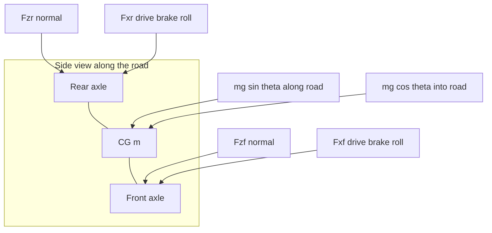
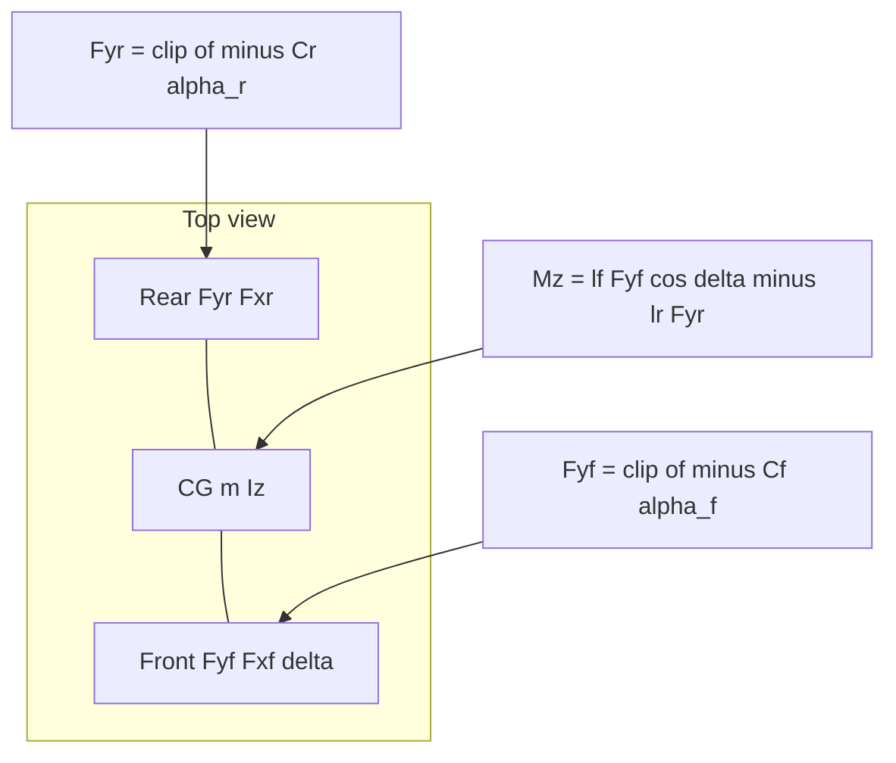
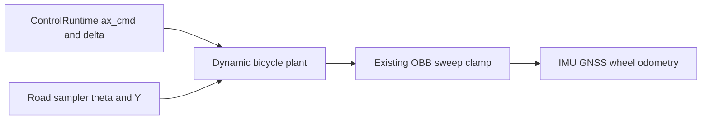

# Vehicle physics roadmap

The `PHY-*` program adds a built-in JavaScript dynamic bicycle: gravity along
the road and tire friction at the two axles. It is not headless PR 13, and it
does not renumber the headless, visual-layer, environment-editor, plugin,
marketplace, or planner programs. Object rigid bodies live in
[`docs/rigid-body-plan.md`](rigid-body-plan.md) and leave this bicycle and the
kinematic characterization tape unchanged.

This revision (2026-10-19) replaces an earlier PHY-01–07 ladder. The product
ask is only to model gravity and friction at the two bicycle axles. Do not
model wheels as springs. A raycast chassis, true contact, world-varying mu,
and Pacejka are deferred. They are not part of this program.

## What prompted this

The program started from wanting real vehicle physics: gravity, colliders, and
whether wheels should roll. A later conversation with someone at Southwest
Research Institute (SWRI) argued that Unity and Unreal are attractive because
ground contact is already built in.

That remains the right pressure (do not invent a general contact solver) and
the wrong conclusion (do not adopt Unity or Unreal, and do not turn Rapier
into a vehicle-dynamics package). Ground is a query. Tire forces live in the
plant. Obstacle contact stays the existing hull.

The scale of this sim does not need sprung wheel colliders. The first useful
ego model is acceleration and steer in, two-axle lateral dynamics, and
gradient resistance from the road. A suspension layer is explicitly later.
This program does not take that layer.

## Status

| Milestone | Implementation | Verification |
| --- | --- | --- |
| PHY-01: contracts | Complete | `tests/physics-contract.test.js`; characterization delta empty |
| PHY-02: dynamic bicycle plant and controls | Complete | `tests/dynamic-bicycle.test.js`; obstacle clamp in `tests/oriented-vehicle-collision.test.js`; kinematic tape unchanged |
| PHY-03: sensors and a second characterization tape | Complete | `tests/localization-sensors.test.js`; browser/headless parity in `tests/headless-vehicle.test.js`; `tests/dynamic-bicycle-characterization.test.js`; `characterization.v1.json` unchanged |

## What is modeled

A single-track dynamic bicycle on the paved surface. Two axles, one center of
gravity. Planar dynamics are in the road-tangent frame. Pose Y and pitch still
come from the existing road sampler. That drape is a kinematic constraint, not
suspension.

States are body-frame `vx`, `vy`, and yaw rate `r`, plus world `X`, `Z`, and
yaw. Pitch is sampled, not a dynamic state.

Inputs are the applied front steer `δ`, already delayed and limited by
`ControlRuntime`, and a longitudinal acceleration command `ax_cmd`. Velocity
mode becomes a speed loop that outputs `ax_cmd`. It does not write
`velocity.x = speed`.

Manifest parameters, with defaults: mass `m` = 1500 kg, yaw inertia `Iz` =
2250 kg·m², front and rear cornering stiffness `Cf` and `Cr` = 80000 N/rad,
friction coefficient `μ` = 0.9, rolling-resistance coefficient `Crr` = 0.015,
and `g` = 9.81 m/s². `g` is not a manifest field. `lf` and `lr` are not
manifest fields. PHY-02 derives them from version-3 axles or wheel
`position.x` when those are present, and otherwise splits
`kinematics.wheelbase` in half. An IGVC manifest with `wheels: []` must keep
working.

Modeled forces and moments:

- Gravity along the road, `mg sin(θ)`, from the sampler pitch `θ`. Downhill
  accelerates `+vx`. Uphill (`θ > 0`) opposes `+vx`.
- Gravity into the road, `mg cos(θ)`, sets the static axle normals only:
  `Fzf = mg cos(θ) · lr / L` and `Fzr = mg cos(θ) · lf / L`. This is a
  holonomic road constraint, not a spring. `Fzf + Fzr = mg cos(θ)`.
- Lateral tire force at each axle, `Fy = -C α`, then clipped so
  `|Fy| ≤ μ Fz`.
- Longitudinal friction as one lumped drive/brake force `m · ax_cmd`, plus
  rolling resistance `Crr · mg cos(θ)` opposing `vx`. Scale `Fx` so the
  longitudinal and lateral pair stays inside `|F| ≤ μ Fz`.
- Yaw moment `lf · Fyf · cos(δ) - lr · Fyr`, plus the steer contribution
  `lf · Fxf · sin(δ)`.

Slip angles, body `+x` forward:

- `αf = arctan((vy + lf · r) / vx) - δ`
- `αr = arctan((vy - lr · r) / vx)`

Guard `vx ≈ 0`. At rest the lateral force is 0. There is no divide-by-zero.

Newton–Euler in the body frame, integrated by the plant:

- `m (v̇x - r vy) = Fxf cos(δ) - Fyf sin(δ) + Fxr - mg sin(θ)`
- `m (v̇y + r vx) = Fxf sin(δ) + Fyf cos(δ) + Fyr`
- `Iz ṙ = lf (Fxf sin(δ) + Fyf cos(δ)) - lr Fyr`

The sign on `mg sin(θ)` follows the road sampler. `pitchFromTangent` is
`atan2(rise, run)` along the vehicle heading, so a positive pitch is uphill
and opposes `+vx`. Use the trigonometric form in the integrator. The
small-angle form is acceptable only for tests at modest steer.

World motion keeps the kinematic plant's yaw convention:
`Ẋ = vx cos(ψ) - vy sin(ψ)` on Z. Keep the Y/pitch drape and the existing
oriented-box obstacle clamp. After a clamp shortens the pose, zero or project
`vx` and `vy` so the next step does not drive back into the wall. Do not add a
contact solver.

## Free-body diagrams

Forces live in the road-tangent frame. The vehicle is a rigid bar `lf + lr`
with the center of gravity between two axle patches. The road normal replaces
any spring.

Normal forces are not spring forces. If an axle would need `|F| > μ Fz`,
saturate. There is no vertical ODE.

## Explicitly not modeled

- Suspension springs, dampers, droop, or per-wheel load from travel
- Four separate wheels, wheel spin, drive shafts, or engine and brake maps
- Longitudinal load transfer and roll or camber
- Full Pacejka or TMeasy, and world-varying mu
- Airborne 6-DOF, Rapier dynamic vehicles, and road meshes as drive contact
- Replacing `tests/fixtures/headless/characterization.v1.json` in place

## Architecture

`KinematicVehiclePlant` stays `motionModel: "bicycle"` for characterization,
scenario keyframes, linear motion, and a plugin plant. `dynamic-bicycle` is a
sibling branch. `HeadlessVehicleManager` and `attachVehiclePlant` dispatch on
the definition. Do not put the integrator in a Three.js vehicle class. Do not
enable Rapier gravity on the vehicle.

## Model identity

| Id | Meaning |
| --- | --- |
| `kinematic-bicycle-v1` | Current built-in bicycle. Omitted `dynamics` normalizes to this. |
| `dynamic-bicycle-v1` | This plant. Manifest physical fields are filled from the defaults above. The plant integrates and the host drapes height and pitch. |
| `contact-bicycle-v1` | Tire forces at the two axles. The host adds gravity, integrates the body, and lifts the car only after it has gone through the pavement. |

These ids are vehicle-manifest model ids. They are not `backendSelections`
entries, and this program does not add a protobuf backend kind. A dynamic
manifest changes `simulationSemanticHash`, and through it `episodeHash`,
because the resolved manifest is already inside the simulation semantic
projection. An explicit `kinematic-bicycle-v1` hashes the same as omitted
dynamics. `VEHICLE_PLANT_VERSION` stays 1. `PHYSICS_BACKEND_CONFIG` stays as
it is.

`dynamics.plant` cannot be combined with `dynamic-bicycle-v1` or
`contact-bicycle-v1`. A plugin plant replaces the built-in model. The built-in
model is not implemented as a plugin.

New editor vehicles and URDF imports use `contact-bicycle-v1`.
`createBlankVehicleManifest()`, built-in vehicles, existing documents, received
bundles, and `characterization.v1.json` stay on the kinematic bicycle.
`characterization.dynamic-bicycle.v1.json` stays the draped dynamic plant.
`characterization.contact-bicycle.v1.json` records the contact plant.

## Locked decisions

### PHY-D01 — JavaScript built-in, plugin override

The dynamic bicycle is a built-in JavaScript plant. `dynamics.plant` remains
an override. It is not the implementation of this model. A plugin may copy
the same equations by setting plant `model` to `dynamic-bicycle-v1`. That
copy does not replace either characterization tape.

### PHY-D02 — Manifest identity, unchanged protobuf

Motion-model identity is the vehicle manifest `dynamics` block. PHY-01 does
not change `headless.proto`, backend admission, or the physics backend config
hash.

### PHY-D03 — Kinematic tape stays the pin

`motionModel: "bicycle"` and `characterization.v1.json` stay the reviewed
kinematic contract. `npm run fixtures:headless` must keep producing an empty
delta for that file. The new-run default does not flip in PHY-01.

### PHY-D04 — Two-axle friction, no suspension

Scope is gravity and Coulomb-limited linear tire forces at two axles. Springs,
wheel spin, four-wheel rays, and Rapier drive contact are out of this program.

## Required verification

PHY-01 runs `tests/physics-contract.test.js`, `npm run lint`, `npm test`, and
`npm run fixtures:headless` with an empty fixture delta.

PHY-02 runs `tests/dynamic-bicycle.test.js` and keeps the kinematic characterization match.

PHY-03 runs browser/headless plant parity at the existing `1e-9` tolerance and
writes a second characterization tape.

## Progress and decision log

### 2026-10-27 — Contact stopping without speed hunting

`run-20261028T014154935Z-da1fd9a3` reaches about -1.00 m/s and then
+0.34 m/s with a zero speed target on the flat floor. The contact plant no
longer uses the legacy one-step speed-error command followed by a jerk clamp.
Its speed/stop loop integrates a critically damped jerk command from speed
error and the previous realized body acceleration. Bandwidth is
`min(4, 2 J / max(A, D, 1e-9), 0.5 / dt)`; acceleration and jerk still obey
the existing actuator limits. Hold and acceleration modes are unchanged.
Loss of contact clears the command and damping feedback; reset and landing
cannot retain an airborne braking sample. Contact canonical state now includes
`axCommand` and `contactControlActive`, which affect subsequent steps.
The shared runtime context retains the complete contact plant snapshot even
when a browser vehicle view exposes only pose/velocity fields; legacy
kinematic and draped dynamic canonical snapshots are unchanged. A focused
40-test snapshot/kernel/determinism/reset/characterization gate passes.

Rolling resistance is bounded by the impulse needed to reach rest after
drive and grade: `clip(-m vx / dt - drive - m gradeX, Crr N)`.
The zero-duration force query retains finite static/friction behavior, while
a zero-duration vehicle update is a no-op. Axle shares, tire friction limits,
gentle-grade support, and downhill motion beyond available friction remain.
All three Rust examples and the local plugin use the same rolling equation.
ABI 1, manifest/Protobuf schemas, model IDs, and `worldHash` are unchanged.

The sanitized `contact-stopping-regression.v1.json` retains the recorded road,
vehicle geometry and 126 keyboard transitions, without sensors or assets.
Stopping tests inspect every step for reversal, command limits, settling and
ten-second rest drift across 10, 16.67, 50 and 100 ms timesteps. They cover
forward/reverse targets, recorded and maximum steering, near-rest rolling,
landing/reset, nondefault limits and browser/numeric replay. Compiled local
WASM matches the JavaScript replay within 1e-9 using identical half-wheelbase
axles; the package cannot read authored asymmetric axle centers through ABI 1.
Regeneration leaves all three characterization tapes unchanged relative to
the preceding contact-support correction, including the contact tape's
acceleration-mode samples. Focused gates pass (40 contact/characterization/
compiled-example checks and 49 stopping/collision/vehicle/sensor checks),
as do the seven native Rust example tests.

Acceptance: the 5,018-step reported-input replay has peak lateral speed
2.437807 m/s during landing, no final-stop reversal beyond roundoff, and
zero measurable displacement over the final ten seconds (speed below
3.5e-15 m/s). The rebuilt/reimported local 0.1.2 kit passes its full native,
tape, predict, wire, Zenoh loopback and compiled-WASM parity suite.
Fresh browser run `run-20261028T020535412Z-cd802b0c`, recording
`log-20261028T020609Z-5y3cmi`, covers 3,970 steps (66.166668 seconds),
reaches +4.999983 and -4.994045 m/s, and stops on the floor at Y 0.0171 m.
Neither release reverses direction; the final ten seconds have exactly zero
logged forward speed and pose drift. A separate steered incline probe,
`run-20261028T020120024Z-cd802b0c`, retains slow cross-slope sliding
(about 0.16 m over ten seconds). Static cross-slope parking is not added by
this correction; the existing cross-slope gravity/sliding behavior is retained.

ESLint passes with the same three existing hook warnings. Full `npm test`
reports 2,411 passed, two failed, two cancelled and eight skipped. The
unrelated artifact deadlines in `run-package-storage.test.js` and
`visual-asset-pack.test.js` pass without full-suite load; the isolated rerun
of those files plus `vehicle-hierarchy.test.js` is 23 passed and one failed,
the same existing LiDAR-zone row assertion at line 21. Neither failure area
was changed for this correction. Both repository whitespace checks pass.
The final full-suite rerun with bounded concurrency
(`node --experimental-default-type=module --test --test-concurrency=4 tests/*.test.js`)
reports 2,415 passed, one failed, zero cancelled and eight skipped. Only the
same hierarchy assertion remains; all artifact deadline cases pass. Final
lint and the local compiled-WASM replay/parity rerun also pass.

### 2026-10-27 — Contact support and reverse-slip correction

The contact model uses the higher road or enabled environment floor, with the
road winning equal surface heights. Tire forces, settling, and floor contact
events use that same choice; a buried road cannot disable floor traction.
The floor's Rapier collider toggle still does not disable vehicle support.
Contact pitch follows the surface normal along the vehicle heading. Its
orthonormal tangent frame includes lateral downhill motion, while visual roll
stays zero. Wheel-cylinder support against that plane determines rest height.
The earlier world-Y-only clearance approximation below is superseded.

Axle slip uses tire-frame velocities and `atan2(v_lateral,
max(abs(v_longitudinal), 1e-3))`. Reverse and zero-forward-speed sliding receive
dissipative friction. A `dt`-dependent impulse limit uses row sums of the
coupled lateral/yaw inverse-mass matrix to prevent low-speed overshoot.
The recorded ramp drop is reduced to `contact-ramp-regression.v1.json`;
browser/numeric replay, passive-energy, support, and tire-force tests cover it.
The contact characterization changes its low-speed steering samples (steps
14-21), replacing alternating saturated lateral accelerations with damped
motion. Kinematic and draped dynamic characterization tapes, model IDs,
`VEHICLE_PLANT_VERSION`, schemas, and `worldHash` remain unchanged.

Acceptance: the compiled contact example and local WASM match JavaScript;
the local kit's full native/tape/predict/wire/Zenoh/parity suite passes.
The original keyboard regression matches browser/numeric state within 1e-9,
peaks at 2.437807 m/s lateral speed during landing, and stops after release.
A fresh browser run, `run-20261028T013057868Z-da1fd9a3`, recorded 3,268 steps
with plugin 0.1.1, reached 4.332591 m/s horizontal speed under forward input,
and finished at zero velocity with origin Y 0.0171 m. Its complete recording
is `log-20261028T013057Z-lekd1k`. Both pinned older tapes have an empty delta.
ESLint reports zero errors and three existing hook warnings. The full Node
suite reports 2,406 passed, eight skipped, and three failures: Marketplace
publisher/CLI timeouts (both files pass separately, 2/2 and 5/5), and the
existing LiDAR-zone row assertion in the unchanged vehicle-hierarchy test
(also fails alone). The 27 focused contact/compiled-plant/oracle checks pass.

### 2026-10-27 — Contact rest height

A contact car whose tire tread hangs below the origin rests that origin on the tread, on the road and on the checker. The hold is the surface plus `groundClearance`, the deepest `radius - axle height`. Clearance is 0 when the tread is on or above the origin, or when the car has no wheels, and then the origin still rests on the surface. The offset is world Y. Kinematic and dynamic cars still rest the origin on the surface. Both older characterization tapes, the contact tape, and `worldHash` stay as they were.

### 2026-10-24 — Contact floor

With the environment floor enabled, a contact car that falls through the checker lands on that plane and can drive. A road underneath still wins. Floor off, and no pavement, the car keeps falling.

### 2026-10-23 — Contact bicycle

`contact-bicycle-v1` returns per-axle forces in the car frame. The host adds gravity, integrates `vx`, right-positive `vy`, yaw rate, pose, and vertical speed, then lifts the car only if the obstacle sweep left it through the pavement. Pitch follows the road ribbon. Roll stays 0. Off pavement the car keeps falling. Drive force is off in the air. `dynamic-bicycle-v1`, both older characterization tapes, and `VEHICLE_PLANT_VERSION` stay as they were. New editor vehicles and URDF imports use the contact model. The three `acme.dynamics` crates emit the same axle forces.

### 2026-10-20 — Plugin copy of the dynamic bicycle

`examples/plugins/acme.dynamics.longitudinal`, `acme.dynamics.cornering`, and
`acme.dynamics.bicycle` copy this plant in stages. The last one matches
`stepDynamicBicycle` when `lf` and `lr` are half the wheelbase. The JavaScript
plant stays the built-in model. `characterization.v1.json` and
`characterization.dynamic-bicycle.v1.json` stay pinned.

### 2026-10-19 — PHY-01

`dynamics.model` accepts `kinematic-bicycle-v1` and `dynamic-bicycle-v1`.
Kinematic normalizes to omitted `dynamics`, so existing manifest hashes stay
put. `dynamic-bicycle-v1` stores mass, yaw inertia, front and rear cornering
stiffness, friction, and rolling resistance, filling the defaults in
`DEFAULT_DYNAMIC_BICYCLE` when a field is omitted. A plugin `plant` combined
with the dynamic model is rejected. The plant factory derives
`motionModel: "dynamic-bicycle"` and copies those fields onto the definition.
`KinematicVehiclePlant` throws for that model until PHY-02 implements the
integrator, so a requested dynamic plant cannot silently run as kinematic.
`VEHICLE_PLANT_VERSION` stays 1. No protobuf or backend-selection change.
Built-in vehicles stay on `bicycle` or `scenario-keyframes`.

### 2026-10-20 — PHY-02

The built-in plant integrates the dynamic bicycle: body `vx`, `vy`, and yaw
rate, gravity from the draped pitch, and Coulomb-limited linear axle forces.
Velocity mode is a jerk-limited speed loop onto `ax_cmd`. Acceleration mode
writes `ax_cmd` and does not snap `velocity.x`. A shortened obstacle step
removes the into-wall part of `vx` and `vy` for this model only. New editor
vehicles and URDF imports store `dynamic-bicycle-v1`. The blank helper,
built-in vehicles, and `characterization.v1.json` stay kinematic.
`VEHICLE_PLANT_VERSION` stays 1.

### 2026-10-20 — PHY-03

IMU and wheel odometry read the dynamic plant. Body `vx`, right-positive
`vy` flipped into REP-103, yaw rate, and the plant's body-component
derivatives feed the existing `ω×v` correction. Kinematic snapshots still
finite-difference `velocity.x` and use `v/L tan(δ)`. Browser and headless
plants match within `1e-9` on the dynamic tape.
`characterization.dynamic-bicycle.v1.json` records that tape.
`characterization.v1.json` is unchanged. `VEHICLE_PLANT_VERSION` stays 1.
