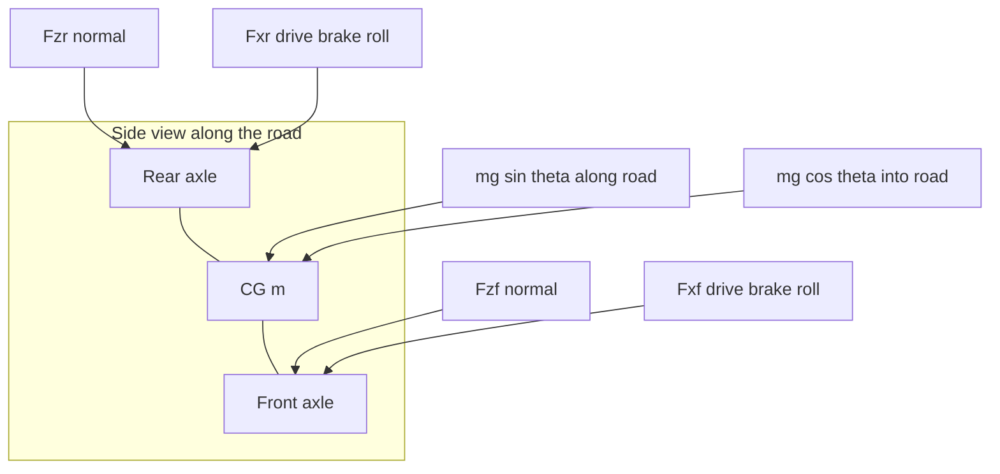
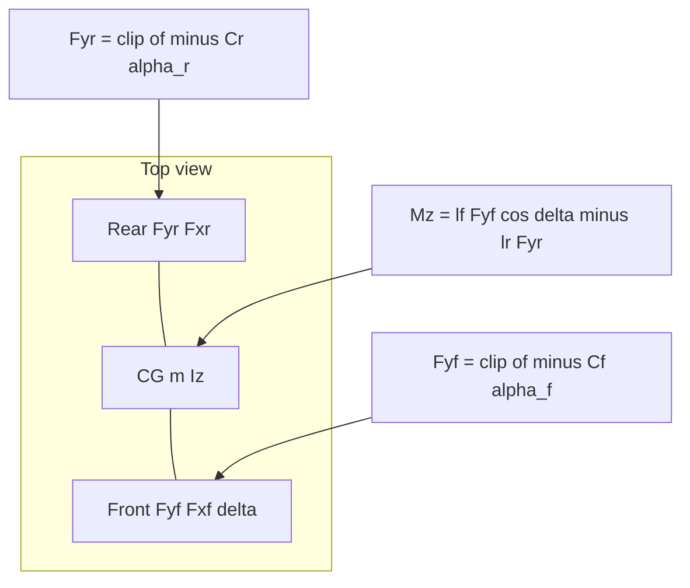
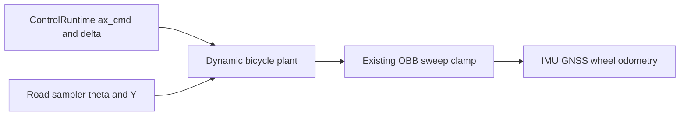

# Vehicle physics roadmap

The `PHY-*` program adds a built-in JavaScript dynamic bicycle: gravity along
the road and tire friction at the two axles. It is not headless PR 13, and it
does not renumber the headless, visual-layer, environment-editor, plugin,
marketplace, or planner programs.

This revision (2026-10-19) replaces an earlier PHY-01–07 ladder. The product
ask is only to model gravity and friction at the two bicycle axles. Do not
model wheels as springs. A raycast chassis, true contact, world-varying mu,
and Pacejka are deferred. They are not part of this program.

## What prompted this

The program started from wanting real vehicle physics: gravity, colliders, and
whether wheels should roll. A later conversation with someone at Southwest
Research Institute (SWRI) argued that Unity and Unreal are attractive because
ground contact is already built in.

That remains the right pressure (do not invent a general contact solver) and
the wrong conclusion (do not adopt Unity or Unreal, and do not turn Rapier
into a vehicle-dynamics package). Ground is a query. Tire forces live in the
plant. Obstacle contact stays the existing hull.

The scale of this sim does not need sprung wheel colliders. The first useful
ego model is acceleration and steer in, two-axle lateral dynamics, and
gradient resistance from the road. A suspension layer is explicitly later.
This program does not take that layer.

## Status

| Milestone | Implementation | Verification |
| --- | --- | --- |
| PHY-01: contracts | Complete | `tests/physics-contract.test.js`; characterization delta empty |
| PHY-02: dynamic bicycle plant and controls | Pending | slope, straight, step-steer, and friction-circle tests; kinematic tape unchanged |
| PHY-03: sensors and a second characterization tape | Pending | IMU and wheel-odometry consumers; do not overwrite `characterization.v1.json` |

## What is modeled

A single-track dynamic bicycle on the paved surface. Two axles, one center of
gravity. Planar dynamics are in the road-tangent frame. Pose Y and pitch still
come from the existing road sampler. That drape is a kinematic constraint, not
suspension.

States are body-frame `vx`, `vy`, and yaw rate `r`, plus world `X`, `Z`, and
yaw. Pitch is sampled, not a dynamic state.

Inputs are the applied front steer `δ`, already delayed and limited by
`ControlRuntime`, and a longitudinal acceleration command `ax_cmd`. Velocity
mode becomes a speed loop that outputs `ax_cmd`. It does not write
`velocity.x = speed`.

Manifest parameters, with defaults: mass `m` = 1500 kg, yaw inertia `Iz` =
2250 kg·m², front and rear cornering stiffness `Cf` and `Cr` = 80000 N/rad,
friction coefficient `μ` = 0.9, rolling-resistance coefficient `Crr` = 0.015,
and `g` = 9.81 m/s². `g` is not a manifest field. `lf` and `lr` are not
manifest fields. PHY-02 derives them from version-3 axles or wheel
`position.x` when those are present, and otherwise splits
`kinematics.wheelbase` in half. An IGVC manifest with `wheels: []` must keep
working.

Modeled forces and moments:

- Gravity along the road, `mg sin(θ)`, from the sampler pitch `θ`. Downhill
  accelerates `+vx`. Uphill (`θ > 0`) opposes `+vx`.
- Gravity into the road, `mg cos(θ)`, sets the static axle normals only:
  `Fzf = mg cos(θ) · lr / L` and `Fzr = mg cos(θ) · lf / L`. This is a
  holonomic road constraint, not a spring. `Fzf + Fzr = mg cos(θ)`.
- Lateral tire force at each axle, `Fy = -C α`, then clipped so
  `|Fy| ≤ μ Fz`.
- Longitudinal friction as one lumped drive/brake force `m · ax_cmd`, plus
  rolling resistance `Crr · mg cos(θ)` opposing `vx`. Scale `Fx` so the
  longitudinal and lateral pair stays inside `|F| ≤ μ Fz`.
- Yaw moment `lf · Fyf · cos(δ) - lr · Fyr`, plus the steer contribution
  `lf · Fxf · sin(δ)`.

Slip angles, body `+x` forward:

- `αf = arctan((vy + lf · r) / vx) - δ`
- `αr = arctan((vy - lr · r) / vx)`

Guard `vx ≈ 0`. At rest the lateral force is 0. There is no divide-by-zero.

Newton–Euler in the body frame, integrated by the plant:

- `m (v̇x - r vy) = Fxf cos(δ) - Fyf sin(δ) + Fxr - mg sin(θ)`
- `m (v̇y + r vx) = Fxf sin(δ) + Fyf cos(δ) + Fyr`
- `Iz ṙ = lf (Fxf sin(δ) + Fyf cos(δ)) - lr Fyr`

The sign on `mg sin(θ)` follows the road sampler. `pitchFromTangent` is
`atan2(rise, run)` along the vehicle heading, so a positive pitch is uphill
and opposes `+vx`. Use the trigonometric form in the integrator. The
small-angle form is acceptable only for tests at modest steer.

World motion keeps the kinematic plant's yaw convention:
`Ẋ = vx cos(ψ) - vy sin(ψ)` on Z. Keep the Y/pitch drape and the existing
oriented-box obstacle clamp. After a clamp shortens the pose, zero or project
`vx` and `vy` so the next step does not drive back into the wall. Do not add a
contact solver.

## Free-body diagrams

Forces live in the road-tangent frame. The vehicle is a rigid bar `lf + lr`
with the center of gravity between two axle patches. The road normal replaces
any spring.

Normal forces are not spring forces. If an axle would need `|F| > μ Fz`,
saturate. There is no vertical ODE.

## Explicitly not modeled

- Suspension springs, dampers, droop, or per-wheel load from travel
- Four separate wheels, wheel spin, drive shafts, or engine and brake maps
- Longitudinal load transfer and roll or camber
- Full Pacejka or TMeasy, and world-varying mu
- Airborne 6-DOF, Rapier dynamic vehicles, and road meshes as drive contact
- Replacing `tests/fixtures/headless/characterization.v1.json` in place

## Architecture

`KinematicVehiclePlant` stays `motionModel: "bicycle"` for characterization,
scenario keyframes, linear motion, and a plugin plant. `dynamic-bicycle` is a
sibling branch. `HeadlessVehicleManager` and `attachVehiclePlant` dispatch on
the definition. Do not put the integrator in a Three.js vehicle class. Do not
enable Rapier gravity on the vehicle.

## Model identity

| Id | Meaning |
| --- | --- |
| `kinematic-bicycle-v1` | Current built-in bicycle. Omitted `dynamics` normalizes to this. |
| `dynamic-bicycle-v1` | This plant. Manifest physical fields are filled from the defaults above. |

These ids are vehicle-manifest model ids. They are not `backendSelections`
entries, and this program does not add a protobuf backend kind. A dynamic
manifest changes `simulationSemanticHash`, and through it `episodeHash`,
because the resolved manifest is already inside the simulation semantic
projection. An explicit `kinematic-bicycle-v1` hashes the same as omitted
dynamics. `VEHICLE_PLANT_VERSION` stays 1. `PHYSICS_BACKEND_CONFIG` stays as
it is.

`dynamics.plant` and `dynamics.model: "dynamic-bicycle-v1"` cannot both be
set. A plugin plant replaces the built-in model. The built-in model is not
implemented as a plugin.

New authoring runs default to `dynamic-bicycle` only once PHY-02 lands.
Existing documents, received bundles, and `characterization.v1.json` stay on
the kinematic bicycle. PHY-03 adds a second characterization tape and does not
overwrite the first.

## Locked decisions

### PHY-D01 — JavaScript built-in, plugin override

The dynamic bicycle is a built-in JavaScript plant. `dynamics.plant` remains
an override. It is not the implementation of this model.

### PHY-D02 — Manifest identity, unchanged protobuf

Motion-model identity is the vehicle manifest `dynamics` block. PHY-01 does
not change `headless.proto`, backend admission, or the physics backend config
hash.

### PHY-D03 — Kinematic tape stays the pin

`motionModel: "bicycle"` and `characterization.v1.json` stay the reviewed
kinematic contract. `npm run fixtures:headless` must keep producing an empty
delta for that file. The new-run default does not flip in PHY-01.

### PHY-D04 — Two-axle friction, no suspension

Scope is gravity and Coulomb-limited linear tire forces at two axles. Springs,
wheel spin, four-wheel rays, and Rapier drive contact are out of this program.

## Required verification

PHY-01 runs `tests/physics-contract.test.js`, `npm run lint`, `npm test`, and
`npm run fixtures:headless` with an empty fixture delta.

PHY-02 adds plant sanity tests and keeps the kinematic characterization match.

PHY-03 runs browser/headless plant parity at the existing `1e-9` tolerance and
writes a second characterization tape.

## Progress and decision log

### 2026-10-19 — PHY-01

`dynamics.model` accepts `kinematic-bicycle-v1` and `dynamic-bicycle-v1`.
Kinematic normalizes to omitted `dynamics`, so existing manifest hashes stay
put. `dynamic-bicycle-v1` stores mass, yaw inertia, front and rear cornering
stiffness, friction, and rolling resistance, filling the defaults in
`DEFAULT_DYNAMIC_BICYCLE` when a field is omitted. A plugin `plant` combined
with the dynamic model is rejected. The plant factory derives
`motionModel: "dynamic-bicycle"` and copies those fields onto the definition.
`KinematicVehiclePlant` throws for that model until PHY-02 implements the
integrator, so a requested dynamic plant cannot silently run as kinematic.
`VEHICLE_PLANT_VERSION` stays 1. No protobuf or backend-selection change.
Built-in vehicles stay on `bicycle` or `scenario-keyframes`.
