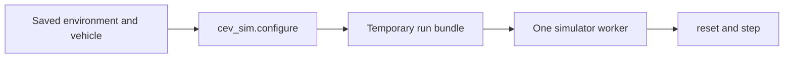

# Getting started with the Python simulator

This tutorial starts a simulator session from Python. You name an environment
and a vehicle. The client builds the run for you, launches one worker, and
hands you a Gymnasium environment.

JavaScript is still the simulator. Python does not step physics itself. Each
`launch` starts one supervisor process and one worker. Closing the environment
stops that process.



A longer reference for bundles, profiles, and Stable-Baselines3 is
[python-headless.md](python-headless.md).

## Install

From a checkout of this repository:

1. Install Node.js `>=22.22.2 <23`.
2. Install the JavaScript dependencies:

```bash
npm install
```

3. Install the Python package. The `viz` extra is only needed for the map window
   in [Watch the car](#watch-the-car).

```bash
python -m pip install -e './python[viz]'
```

4. Check that the client imports:

```bash
python -c "import cev_sim; print(cev_sim.__version__)"
```

`configure` finds `bin/cev-sim.js` in the checkout and runs it with `node`.
You do not put `cev-sim` on `PATH`.

## Find your environments and vehicles

Saved worlds and cars live in a data directory. The client looks in this order:

1. The `data_dir` argument.
2. The `CEV_SIM_DATA_DIR` environment variable.
3. `server/data` in the checkout, when that directory exists.

If none of those exist, only the built-ins are available: the `igvc`
environment and the `big-car`, `igvc-car`, and `scenario-car` vehicles.

```python
import cev_sim

for entry in cev_sim.environments.list():
    print(entry.id, entry.name, "built-in" if entry.built_in else "saved")
for entry in cev_sim.vehicles.list():
    print(entry.id, entry.name, "built-in" if entry.built_in else "saved")
```

`id` is what you pass to `configure`. `name` is the label from the editor.

## First program: drive with no goal

This is the whole program. It rolls the car forward on the built-in IGVC map.

```python
import numpy as np

import cev_sim

config = cev_sim.configure(
    environment="igvc",
    vehicle="big-car",
    goal=None,
)
with cev_sim.launch(config) as sim:
    observation, info = sim.reset(seed=1)
    for _ in range(300):
        action = np.array([0.35, 0.0], dtype=np.float32)
        observation, reward, terminated, truncated, info = sim.step(action)
        if terminated or truncated:
            print(info["termination_reason"], info["truncation_reason"])
            break
```

Save it as `drive.py` and run `python drive.py` from the checkout.

What each piece does:

| Piece | Meaning |
| --- | --- |
| `environment` | The saved or built-in map id. |
| `vehicle` | The car id. Omit it to use `big-car`. |
| `goal=None` | Free drive. Reaching the far end of the road does not end the episode. |
| `launch` | Starts one worker. The `with` block closes it, even if the loop raises. |
| `reset(seed=1)` | Places the car and starts a repeatable episode. |
| `step` | One action. The array is `[speed, steer]`, each in `[-1, 1]`. |

`configure` also accepts `start=(x, z)`. Those are meters on the ground. The
second number is `z`, not height. If you omit the heading, the car faces along
the nearest part of the road. `start=(x, z, yaw)` sets the heading yourself.
`yaw` is rotation about the vertical axis. Forward is `(cos(yaw), -sin(yaw))`
in `(x, z)`.

The same program is `python/examples/00_free_drive.py`:

```bash
python python/examples/00_free_drive.py --steps 50
```

`--environment` and `--vehicle` default to `igvc` and `big-car`.

### How an episode ends

`step` returns `terminated` and `truncated`.

- `terminated` is a real ending. `info["termination_reason"]` is `success`,
  `collision`, `off_road`, or another scenario failure.
- `truncated` is the step limit. `info["truncation_reason"]` is
  `max_episode_steps`. The car did not finish a task.
- A free drive does not use `success`. It ends on a collision, leaving the
  road, the step limit, or when your loop stops.

`reward` is the route-safety score. It is not required for driving the car.

After `terminated` or `truncated`, call `reset` before `step` again.

## Start and stop the worker

`with cev_sim.launch(config)` is the usual shape. It calls `close()` when the
block ends.

Without `with`:

```python
sim = cev_sim.launch(config)
try:
    sim.reset(seed=1)
finally:
    sim.close()
```

`close()` stops the worker and deletes a temporary log directory. Keep `config`
until `close()` returns. `launch` holds it for you as `sim.run_config`.

Three ways to stop the drive:

- `break` out of the loop, then leave the `with` block.
- `max_steps=300` on `configure`. The next `step` after that comes back
  `truncated`.
- Let the car hit something or leave the pavement. That comes back `terminated`.

`max_steps=0`, the default, means no step limit.

## Drive to a goal

Set `goal` to a ground point. The episode ends with `success` when the car is
within `goal_tolerance_m` (default 1 meter). Heading is not checked unless you
also pass a tighter yaw tolerance on `reset`.

A goal from `configure` is applied on every `reset`. `config.world.goal` is
the far end of the verified route. This session ends there:

```python
preview = cev_sim.configure(environment="igvc", vehicle="big-car", goal=None)
goal = (preview.world.goal.x, preview.world.goal.z)
preview.close()
config = cev_sim.configure(
    environment="igvc",
    vehicle="big-car",
    goal=goal,
    goal_tolerance_m=1.0,
)
```

Leaving `goal=None` means arriving at that point changes nothing. You can also
pass the goal on a single `reset` without building a second config. See
[Change the start or goal for one episode](#change-the-start-or-goal-for-one-episode).

## A controller

`view` defaults to `"planning"`, so each observation includes the true pose.
`config.world.route_polyline` is the road centerline as `(x, z)` points.
Pure pursuit steers toward a point a few meters ahead on that line.

```python
import numpy as np

import cev_sim
from cev_sim.world import direction_from_yaw

config = cev_sim.configure(environment="igvc", vehicle="big-car", goal=None)
world = config.world

def control(observation):
    pose = observation["oracle/ego/pose"]
    points = np.asarray(world.route_polyline, dtype=np.float64)
    position = np.array([pose[0], pose[1]], dtype=np.float64)
    nearest = int(np.argmin(np.linalg.norm(points - position, axis=1)))
    target = points[min(nearest + 4, len(points) - 1)]
    delta = target - position
    forward_x, forward_z = direction_from_yaw(float(pose[2]))
    forward = float(delta[0] * forward_x + delta[1] * forward_z)
    lateral = float(delta[0] * np.sin(pose[2]) + delta[1] * np.cos(pose[2]))
    steer = np.arctan2(lateral, forward) / world.vehicle.max_steering_rad
    return np.array([0.35, np.clip(steer, -1.0, 1.0)], dtype=np.float32)

with cev_sim.launch(config) as sim:
    observation, info = sim.reset(seed=1)
    for _ in range(400):
        observation, reward, terminated, truncated, info = sim.step(control(observation))
        if terminated or truncated:
            break
```

Examples `01` through `04` in `python/examples/` use the same idea for pure
pursuit, A*, RRT*, and a short kinematic MPC.

## Change the start or goal for one episode

`configure` fixes the map and the car. `reset` can move the start and the goal
without building another bundle.

```python
observation, info = sim.reset(
    seed=2,
    options={
        "start_pose": (world.start.x, world.start.z, world.start.yaw),
        "goal": (world.goal.x, world.goal.z),
        "position_tolerance_m": 1.0,
    },
)
```

Keys you pass replace the same keys from `configure`. A start that leaves the
road or overlaps an obstacle is rejected. Fix the numbers and call `reset`
again. `close()` is only for shutting the worker down.

`info["episode_hash"]` changes when a start or a goal is present. Two episodes
with the same seed and the same options repeat.

## Watch the car

Install the `viz` extra, then ask `launch` for a window. The window needs the
planning view, which is already the default.

```python
with cev_sim.launch(config, render_mode="human") as sim:
    observation, info = sim.reset(seed=1)
    sim.set_overlay(world.route_polyline)
    sim.step(np.array([0.35, 0.0], dtype=np.float32))
```

`set_overlay` draws an extra polyline, such as a planned path. `render_mode`
`"rgb_array"` returns an image instead of opening a window.

## Keep a log

`logging=False`, the default, writes nothing you have to clean up.

```python
config = cev_sim.configure(
    environment="igvc",
    vehicle="big-car",
    logging="runs/first",
)
```

Artifacts stay in `runs/first`. After the session:

```bash
node bin/cev-sim.js inspect runs/first
```

`config.save("my-run.json")` copies the generated run bundle if you want to
open that same snapshot later with `CevSimEnv`.

## After you edit the map

Edit the environment in the editor and save it. Then call `configure` again.
The new session picks up the saved roads. The previous `config` still refers
to the old snapshot. You do not change the Python program when the map changes.

The new bundle has a new `resolvedHash`. That is how the simulator records
which world it ran.

## Planning view and measured view

`view="planning"` adds the true pose, speed, steering, other actors, and the
goal on top of the measured sensors. Use it to test a planner.

`view="measured"` is the training observation. It has IMU, GNSS, wheel
odometry, and task signals. It does not include the true pose. A policy trained
on this view cannot read the answer from the observation.

```python
config = cev_sim.configure(environment="igvc", vehicle="big-car", view="measured")
```

`CevSimEnv(bundle_path)` and `gym.make("CevSim-v0", ...)` still default to the
measured view. Only `configure` defaults to planning.

## What to use next

- `python/examples/00_free_drive.py` through `04_mpc_kinematic.py` for the
  controllers above.
- Stable-Baselines3 on a configured bundle:

```python
from stable_baselines3 import PPO

from cev_sim.sb3 import CevSimVecEnv

config = cev_sim.configure(environment="igvc", vehicle="big-car", view="measured", max_steps=1000)
env = CevSimVecEnv(str(config.bundle_path), 4, episode=config.episode)
try:
    PPO("MultiInputPolicy", env, n_steps=128, batch_size=256).learn(10_000)
finally:
    env.close()
```

- An existing exported bundle, when you already have one:

```python
from cev_sim import CevSimEnv

with CevSimEnv("python/examples/bundles/straight.json") as sim:
    sim.reset(seed=1)
```

## Troubleshooting

**Node.js version.** `launch` and `configure` refuse a Node outside
`>=22.22.2 <23`. `node --version` shows the one on your `PATH`.

**Unknown environment or vehicle.** `environments.list()` and `vehicles.list()`
show the ids the client can see. A saved world is invisible when
`CEV_SIM_DATA_DIR` points somewhere else. Pass `data_dir="server/data"`.

**Immediate `off_road`.** The car is wider than the road. `first-demo` is about
1.2 m of pavement. `big-car` is about 1.24 m wide, so it can be marked off the
road at once. `merceves` is about 0.61 m wide and fits. Widen the road, or
choose a narrower vehicle.

**Rejected start.** The point is off the drivable surface or the vehicle box
overlaps an obstacle. Use a point on `config.world.route_polyline`, or omit
`start` and keep the pose `configure` already checked.

**The route looks stale after an edit.** Call `configure` again. An old
`config` or a bundle saved with `config.save` keeps the map from when it was
built.

**`reset()` before `step()`.** Stepping a finished episode raises
`CevSimConfigurationError`. Reset, or stop the loop.
